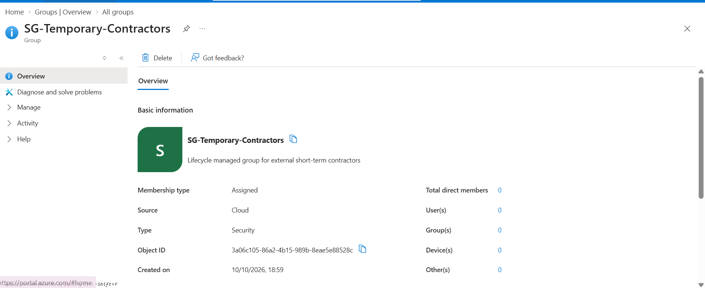
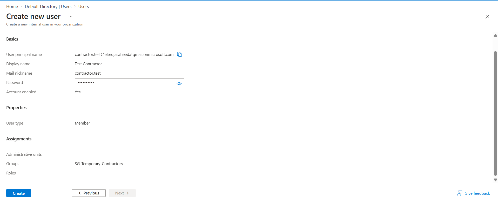
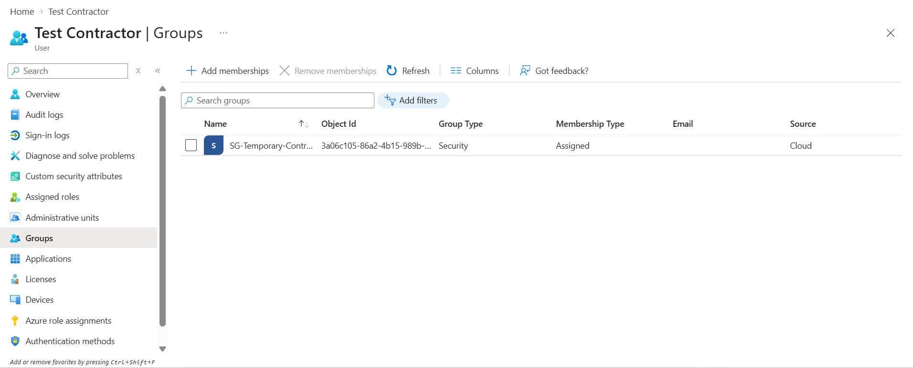
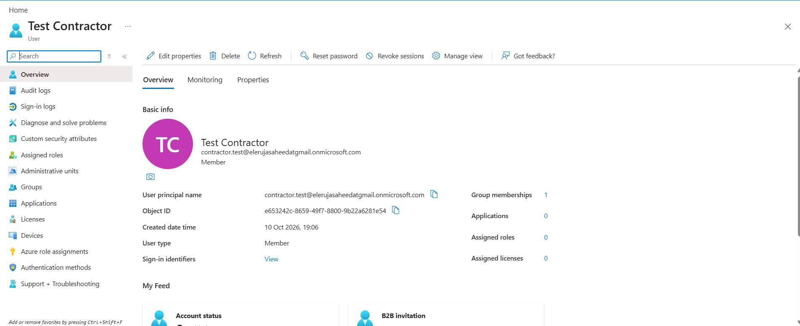
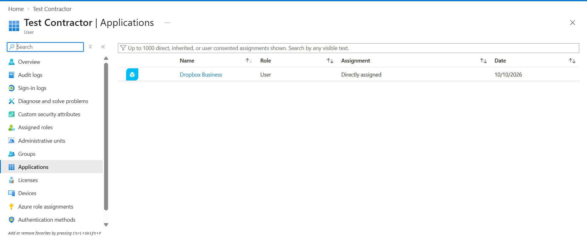
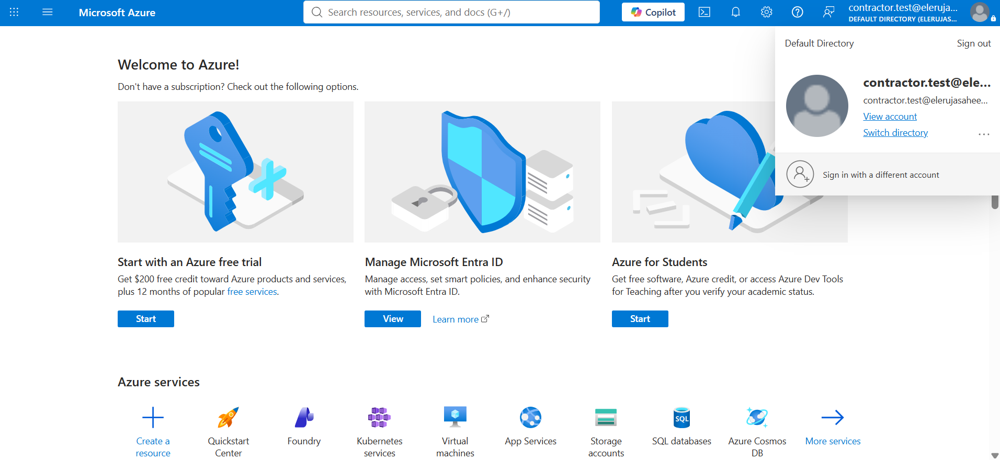
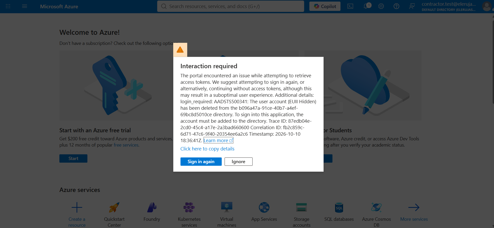

# Identity-Governance-and-Administration-IGA

This project focuses on Identity Governance and Administration (IGA) and lifecycle management (Joiner-Mover-Leaver) using an enterprise identity directory structure, completely independent of cloud storage buckets

## Scenario: The Access Review Crisis at OmniCorp

OmniCorp has 500 employees and relies heavily on an enterprise Identity Provider (IdP) like Microsoft Entra ID or Okta to manage user access to corporate applications (GitHub, Salesforce, Jira, and Workday). Following an external compliance audit, OmniCorp failed its SOC 2 review due to three major findings:

- Dormant Accounts: 45 contractor accounts showed no login activity for over 120 days, but their access tokens remained fully active.

- Permission Accumulation (The "Mover" Flaw): Employees transferring from Marketing to Engineering retained their old Marketing database privileges while accumulating new engineering tools permissions.
  
- Orphaned Admin Accounts: Two former sysadmins who left the company six months ago still possessed active global admin accounts because offboarding was done manually via verbal requests.


## Task: Design and Execute an Enterprise IGA remediation plan

**Part 1: Designing the Automated JML Lifecycle Workflow; a workflow blueprint for OmniCorp specifying the Trigger Source, the Action Taken, and the System of Record**

*OmniCorp uses Workday, a software tool, as the authoritative HR data source classified as a Human Resources Information System (HRIS)*


| **Classification** | **Trigger Source** | **Action Taken (automated workflow)** | **System of Record** | 
| ----  | ------- | --------- | -------- | 
| **Joiner (Onboarding)** | HR creates a new employee record in Workday. The event triggers an automated workflow through the Identity Provider (IdP), such as Microsoft Entra ID | - IdP automatically creates the employee's corporate identity and user account<br>- assigns security groups and application access based on department, job role, and attributes from Workday<br>- provisions accounts to connected SaaS applications using SCIM (System for Cross-domain Identity Management) or supported APIs<br>- enforces MFA enrollment through the IdP's authentication policies before granting access to protected resources | - Workday: authoritative source for employee records, departments, job roles, hiring dates, and termination dates.<br>- IdP: source for identity, authentication, and group membership | 
| **Mover (Internal Transfer)** | HR updates the employee's department, job title, and role in Workday. The change triggers an automated identity governance workflow | - IdP detects the employee's changed attributes<br>- recalculates access according to the new role<br>- removes old department groups, role assignments, and permissions that are no longer required<br>- provisions new groups and application access based on the new role<br>- revokes obsolete application access and log the changes to prevent permission creep | - Workday: authoritative source for employment and role information<br> -IDP / Identity Governance and Administration (IGA): manages access assignments and provisioning |
| **Leaver (Offboarding)** | HR records a termination or contract end date in Workday. A termination event triggers the automated offboarding workflow at the approved effective time | Idp disables the employee's IdP account and block new authentication<br>- revokes active sessions, refresh tokens, and authentication tokens where supported<br>- deprovisions or disable accounts across connected SaaS applications using SCIM or APIs<br>-  removes group memberships, application assignments, and access privileges<br>- records the actions and failures in audit logs and alert security teams if any application cannot be deprovisioned | - Workday: authoritative source for termination status and effective date<br>- IdP / IGA: coordinates identity disablement, session revocation, and downstream deprovisioning<br>- SaaS applications: enforce application level account and session revocation | 


- Why the Mover (Internal Transfer) workflow prevents permission creep: access is assigned based on user attributes and role requirements rather than standing manual exceptions. Because group memberships are rule based, updating a user's attributes triggers the removal of access no longer required and the assignment of access appropriate to the new role. This supports the principle of least privilege by ensuring users retain only the access necessary for their current responsibilities.

*SCIM (System for Cross-domain Identity Management): the identity provisioning protocol that allows OmniCorp's IdP to automatically create, update, and deactivate employee accounts in connected SaaS applications as part of the Joiner-Mover-Leaver lifecycle*


**Part 2: Performing an Access Certification and Audit Campaign**

- *A sample report pulled from the Identity Governance platform contains four high-risk user profiles. Review each profile, identify any compliance or security violations, and determine the appropriate action: Certify (Keep), Modify (Restrict), or Revoke (Terminate) access*


| **User Account** | **Role / Department** | **Last Login Activity** | **Active Entitlements / Groups** | **Compliance Violation / Risk Identified** | **Action Required (Certify / Modify / Revoke) & Justification** | 
| ---- | ----- | ---- | ------ | ----- | ----- | 
| j.doe@omnicorp.com | Marketing Manager | 2 days ago | ```Marketing-All```, ```Jira-Users```, ```Prod-Database-Admin``` | **Least-privilege violation**. The Marketing Manager has unnecessary production database admin access that is not required for his role. Privileged production database access creates risk of data exfiltration, accidental data loss, and exposure of customer PII | **Modify (Restrict):** Remove ```Prod-Database-Admin``` because it gives more access than the job requires and retain ```Marketing-All``` and ```Jira-Users``` required for the role | 
| c.smith@contractor.io | External Developer | 145 days ago | ```GitHub-Core```, ```AWS-Dev-Access``` | **Dormant third-party account**. The account has been inactive for 145 days, creating a risk of unused access that could expose the organization to supply chain attacks and credential compromise | **Revoke (Terminate)**: Disable the account and remove it from both groups until the contract status is confirmed. If access is still required, re-onboarding must be completed with fresh approval and a defined expiry date before access is restored | 
| a.jones@omnicorp.com | Former SysAdmin (Terminated) | 180 days ago | ```Global-Tenant-Admin```, ```Domain-Controllers``` | **Critical: Orphaned privileged account**. A terminated employee still has access to ```Global-Tenant-Admin``` and ```Domain-Controllers``` privileges, which provide the highest levels of access in the environment. This creates a severe risk of unauthorized access and potential compromise of critical systems | **Revoke (Terminate):** Immediately disable the account and revoke all active sessions, credentials, privileged roles, and associated access. Investigate any activity since the employee’s termination, and reset or rotate all shared administrative credentials, service-account passwords, and keys the user may have known | 
| m.chen@omnicorp.com | Transfer: Sales -> Finance | Today | ```Sales-CRM-Full```, ```Finance-Billing-System``` | **Excessive access / Segregation of duties(SoD) violation**. The user retains ```Sales-CRM-Full``` while holding ```Finance-Billing-System``` access after transferring departments. Holding both could allow someone to create or alter customer records and also touch billing, which enables fraud such as fictitious invoices or altered credits | **MODIFY (Restrict)**: Remove ```Sales-CRM-Full```, as the user no longer requires access to it in the Finance role. Retain ```Finance-Billing-System``` only if it is required for the new role and approved by the appropriate owner. Update the user's access profile to reflect the new role

*Key points*
- *Tie deprovisioning to HR termination events, and trigger access reviews on role transfers*
- *Automatically disable accounts after 60 to 90 days without login, with a shorter window for privileged and external accounts*
- *Give every external account a sponsor and an enforced end date*


**Part 3:  Building the Identity Governance an Administration(IGA) Identity Lifecycle and Access Review Lab. Build an automated group-based lifecycle structure, provision a test contractor, assign group-based permissions, and execute an instant offboarding kill-switch**

- Create a Lifecycle Security Group: instead of managing permissions user-by-user (which leads to orphaned accounts and permission creep), enterprise governance requires group-based access control




- Provision a Test Lifecycle User (The Joiner) simulating a new contractor joining OmniCorp by creating a user account with a governance-controlled identity profile and automatically assigning the user to the appropriate contractor security group


 





- Map Group-Based Resource Access (Simulating Entitlements) demonstrating how permissions scale securely via groups rather than individual assignments. Assign an application to the group so the user automatically inherit all permissions attach to that group 




*the user automatically inherits all permissions to applications assigned to their security group*




- Execute the Instant Offboarding (The Leaver / Kill-Switch): simulate the end of the contractor's lifecycle when their contract terminates or audit flags require an immediate lockdown.

*the user logged in to the provisioned user account*




*the user's access was revoked after the account was deprovisioned, simulating the immediate offboarding of the contractor*





## Core Lessons

- **Least Privilege (PoLP)**: users should hold only the entitlements their current role requires. Excess privileged access (Prod-Database-Admin on a marketing account) expands the attack surface and risks data exfiltration and PII exposure.


- **Joiner-Mover-Leaver (JML) Lifecycle**: provision access by role (RBAC), with approval (joiner), trigger a review on role change to prevent privilege creep (Mover), deprovision immediately on termination to prevent orphaned accounts (Leaver)

- **Dormant Account Management**: accounts inactive beyond a defined threshold (60-90 days) should be disabled, with shorter windows for privileged and third-party accounts to reduce unauthorized access risks.

- **Segregation of Duties (SoD)**: no single identity should hold conflicting entitlements (full access to both the CRM and billing systems). This principle prevents conflicting permissions that could enable fraud or unauthorized actions.


## Key Takeaway

Effective access governance reduces excessive privileges, unauthorized access, insider threats, and compliance risks through regular access reviews and timely remediation


